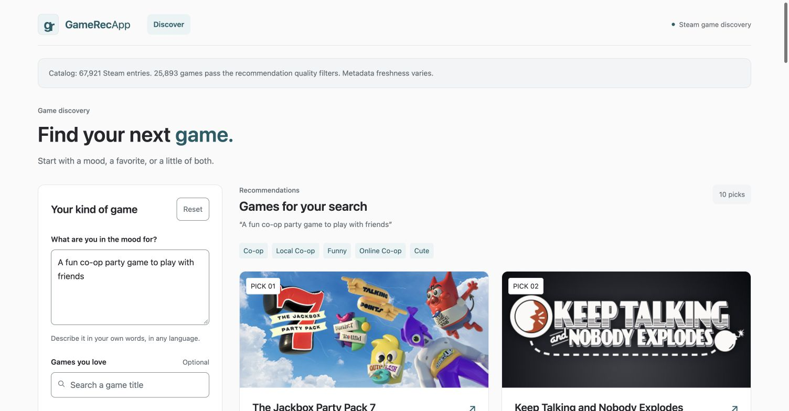

# GameRecApp

[Try the live demo](https://berkkalelioglu.com/find-games/). The hosted demo shares a budget of **100 recommendation searches per UTC day across all visitors**. It resets at 00:00 UTC; title autocomplete does not consume this budget.



A personal hobby project developed with **Claude Code and Codex**, with no expectation of revenue. It is independent and is not affiliated with Valve, Steam or game publishers.


Find Steam games from a description, games you like, or both. A FastAPI backend combines multilingual embeddings, BM25, structured filters and review-quality signals. The browser shows matching evidence, artwork and Steam links.

This repository contains the application, collection and indexing tools, tests and deployment examples. Catalog databases, embeddings, search histories, credentials and internal development reports are not distributed. A clean checkout needs either the fictional demo below or a catalog and matching index you build yourself.

## Quick start

Use Python 3.12. On macOS/Linux:

```sh
python3.12 -m venv .venv
.venv/bin/python -m pip install -r requirements-lock.txt
cp .env.example .env
bash scripts/run_local_demo.sh
```

The demo downloads an embedding model on first use, creates fictional games and builds a local index. Open `http://127.0.0.1:8000/`; API documentation is at `/docs`. Demo results are labeled and do not link fictional entries to real Steam products.

On Windows, create the environment with `py -3.12 -m venv .venv`, install the lock file using `.venv\Scripts\python.exe`, and run the Python modules used in `scripts/run_local_demo.sh` with its environment settings. Recreate the virtual environment after moving between operating systems.

## Use a real catalog

One bounded starting point is the bootstrap collector:

```sh
.venv/bin/python -m scripts.ingest.bootstrap_steam --output-dir data/catalogs/my-snapshot --limit 220
.venv/bin/python -m scripts.index.build_rag --db-path data/catalogs/my-snapshot/games.duckdb --index-path data/catalogs/my-snapshot/rag/games.index --model intfloat/multilingual-e5-small --revision 614241f622f53c4eeff9890bdc4f31cfecc418b3 --quality-candidates-only
.venv/bin/python -m scripts.migrate.activate_bundle --catalog data/catalogs/my-snapshot/games.duckdb --index data/catalogs/my-snapshot/rag/games.index --pointer data/serving.json
```

Configure `ACTIVE_CATALOG_MANIFEST=data/serving.json` and `DEMO_CATALOG=false` in `.env`, then start:

```sh
.venv/bin/python -m uvicorn src.gamerec.serve.api:app --host 127.0.0.1 --port 8000
```

Check `/health` for `components_loaded: true`, inspect `/datasets`, and submit a recommendation. Bootstrap collection is a sample, not complete Steam coverage. Full inventory discovery needs your own `STEAM_WEB_API_KEY`; see [Steam refresh](docs/STEAM_REFRESH.md) for field coverage, request limits and optional weekly jobs. Read the provider's current terms before collecting data.

## How retrieval works

- Multilingual E5 encodes metadata, description windows and available review evidence into normalized vectors.
- Dense retrieval, game-level BM25 and observed tags produce candidates. Reciprocal-rank fusion combines their ranks; filters enforce supported constraints.
- Ranking includes relevance, review quality, popularity preference and selected/disliked games. Optional cross-encoder reranking is disabled by default.
- Result cards expose retrieved evidence. The default recommendation path does not use an LLM to generate answers.

See [recommendation architecture](docs/RECOMMENDATION_ARCHITECTURE.md), [developer guide](DEVELOPER_GUIDE.md) and [interface design](DESIGN.md).

Ranking weights are heuristics, not a proven optimum. Offline support is not a verified hard filter. Catalog completeness and recommendation quality need separate validation. Evaluation scripts and synthetic/query fixtures are included; private benchmark results and model-judgment reports are not.

## Tests

```sh
.venv/bin/python -m pytest -q
.venv/bin/python -m pytest --run-model-tests -q
.venv/bin/python -m ruff check .
.venv/bin/python -m black --check .
.venv/bin/python -m isort --check-only --profile black .
```

Regular tests use temporary databases and skip real-model integration checks. Model tests need cached/downloadable weights. Use independent human relevance labels before making accuracy claims.

## Deployment

[Cloud deployment](DEPLOYMENT_GCP.md) describes optional Docker, Cloud Run and Firebase configuration. `deploy/vps/` provides a CPU container, Compose example and systemd refresh jobs. Configure your own hosts, credentials and storage; nothing deploys automatically from this repository.

The VPS example binds the API to loopback port 4320, mounts a read-only catalog and writes mutable state separately. Set `GAMEREC_IMAGE`, `GAMEREC_CATALOG_DIR` and `GAMEREC_PROXY_NETWORK` for your installation. Create or supply the external proxy network. The image uses UID 10001, so its state directory must be writable by that user. Its default URL prefix is `/find-games`; adapt the reverse proxy and Uvicorn root path together.

## Privacy and contributions

Search history, logs, cloud history, translation and external AI feedback are off by default. Optional integrations require explicit configuration. Never commit real prompts, feedback, catalog exports, keys or local environment files. The MIT license covers this code; third-party game content and models retain their own terms.

Before pushing, run `python scripts/check_public_files.py` and a redacted Gitleaks scan. The file guard rejects private file categories even when they are force-added. CI checks every branch and pull request. Local pre-commit hooks can be installed with `pip install pre-commit && pre-commit install`; do not bypass a failing privacy check.

## Runtime cost and search budget

The hosted demo uses `intfloat/multilingual-e5-small` locally on its server for embeddings. It does not call a generative LLM or a paid model API per search. Translation, AI feedback and cloud search history are disabled there. Optional provider integrations in the source require your own credentials if you enable them.

The API reserves each valid recommendation attempt in `DATA_DIR/search_quota.sqlite3` before inference or optional provider work. A SQLite write transaction enforces the shared daily ceiling across processes; the file must persist across restarts. Failures after reservation still count. Quota storage failures return 503, and exhausted quotas return 429 with a reset hint. Keep every worker on the same local persistent file; multiple independent servers would need a shared transactional counter. The counter stores only the UTC day and total, not queries or user identities.

## Data and licensing

The MIT license covers this project's code. It does not grant rights to game artwork, descriptions, reviews, third-party datasets or model weights. The public repository does not distribute the hosted Steam catalog or embeddings. The current hosted catalog was recovered from an earlier project export; its complete collection history and redistribution permissions have not been independently verified. Do not treat it as a generally licensed downloadable dataset.

Steam content belongs to Valve and the relevant rightsholders. Review the [Steam Web API terms](https://steamcommunity.com/dev/apiterms) for API use; these do not establish permission for every unofficial store endpoint or previously collected dataset. Catalog information and recommendations are provided as-is. The [E5 model card](https://huggingface.co/intfloat/multilingual-e5-small) declares an MIT license for that model. Other models and dependencies retain their own licenses.

The screenshot illustrates the application; third-party game artwork remains the property of its rightsholders. A hobby or noncommercial purpose does not waive third-party license obligations.
